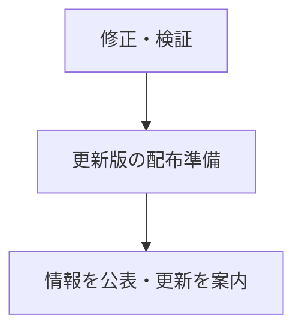
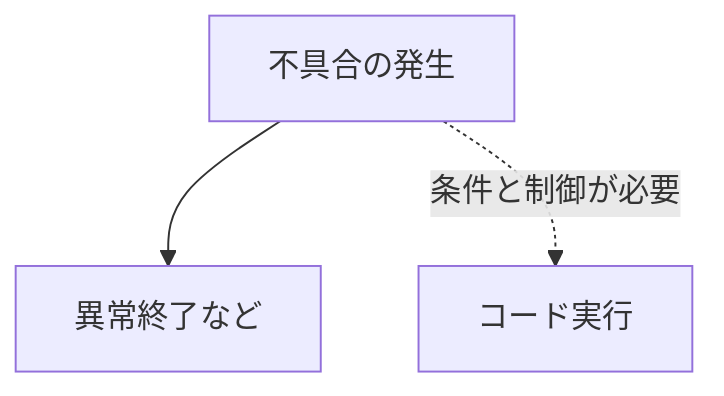

「PHPに深刻な脆弱性」と聞いて、自分が使っているサイトも大丈夫なのか、気になった人もいるかもしれません。

まず、今回の対応を主に進めるのは **サイトやサーバーを管理している側** です。普段サイトを見る人が、この問題のために自分の端末へPHPを入れたり、ブラウザーの設定を変更したりする必要は通常ありません。

ただし、管理者にとっては急いで対応すべき問題です。

今回これだけ注目されたのは、問題の深刻さに加えて、 **修正版の公開前に脆弱性に関する情報が漏れ、予定していた対応の段取りが崩れたこと** にあります。

さらに、攻撃試行も正式公開より先に観測されていました。

この記事では、2026年10月に公表された「PHP2Shell」と呼ばれる2件の脆弱性を、作業机の例えや図を使って整理します。

:::message
2026年10月23日時点の公開情報に基づく解説です。図と挿絵は理解を助けるための模式図で、実際のメモリ配置やサーバー構成をそのまま描いたものではありません。
:::

## 普段は、水面下で修正版を準備してから公表する

脆弱性が見つかっても、開発チームがすぐに詳しい仕組みを公開するとは限りません。

関係者の間で情報を共有し、修正や検証を進めます。OSの配布元やサービス事業者なども、更新版を届ける準備をします。

そして、利用者が対策できる状態にしてから、問題の内容を公表します。こうした進め方を **協調的な脆弱性開示** と呼びます。

「いつもはこっそりPHP側で直している」というイメージに近いですが、目的は隠すことではありません。

**攻撃方法だけが先に知られて、守る側がまだ更新できない時間を短くするため** です。

今回も、そのような調整が進んでいました。ところが、途中で情報が外に出てしまいます。

PHP Foundationの説明によると、10月20日15:00（UTC）頃に脆弱性の識別番号などがネット上に出回りました。最初の漏えいには技術的な詳細は含まれず、誤った公開時刻や深刻度の点数も混ざっていました。

PHP側はこれを受け、同日19:30（UTC）に事前告知を公開しました。あわせて、 **修正版の公開を10月22日から21日へ、1日前倒し** しています。

その後、研究者側の実証動画も誤って公開され、削除後もコピーが拡散しました。[PHP Foundationの経緯説明](https://thephp.foundation/blog/2026/10/21/todays-php-security-release-and-how-were-strengthening-php-security/)

「情報が漏れたなら、すぐに修正版を出せばよいのでは」と思うかもしれません。

しかし、配布元ではまだ更新パッケージを準備している段階でした。ソースコードの修正だけを公開しても、多くの管理者が普段使っている方法ですぐ更新できるとは限りません。

修正を届ける準備と、公表を急ぐ必要との間で、調整を迫られたわけです。

### 攻撃試行も、正式公開より先に観測されていた

さらにAWSは、後から調査した結果、 **10月17日の攻撃試行を観測していた** と報告しています。正式公開の4日前にあたります。

なお、AWSが確認したのは **攻撃の試行** です。実際のシステムで侵入が成功したことまで確認されたわけではありません。[AWSの調査報告](https://aws.amazon.com/tw/blogs/security/amazon-threat-intelligence-identifies-php2shell-exploitation-prior-to-public-disclosure-in-madpot/)

ここは日付を分けて読む必要があります。

| 日時（UTC基準） | 確認されたこと |
|---|---|
| 10月17日 | AWSが攻撃試行を観測。後日の調査で報告 |
| 10月20日 15:00頃 | 識別番号などが漏れる |
| 10月20日 19:30 | PHPが事前告知を公開。修正版の公開を22日から21日へ前倒し |
| 10月20日・事前告知後 | 実証動画が誤って公開され、コピーが拡散 |
| 10月21日 14:00 | PHPが修正版を正式公開 |
| 10月22日 14:00 | 当初予定していた公開日時。21日へ変更された |

攻撃者がどうやって情報を得たのかは分かっていません。17日の試行は20日の漏えいより前なので、 **「今回の漏えいが原因で、その攻撃が始まった」とは断定できません。**

ただ、全体としては、 **公開前に脆弱性の情報が漏れて段取りが崩れ、攻撃試行も正式公開に先行していた** 状況です。

守る側が準備をそろえる前に、攻撃が試されていた。この点が、今回の慌ただしさにつながっています。

## 問題があったのは、サイトを動かすPHP本体

では、どこに問題があったのでしょうか。

Webサイトの裏側を、大まかに3つの層で考えてみます。

上の層は、サイトを作った人のプログラムです。ログイン、記事の表示、商品の購入といった処理を書きます。

真ん中は、そのプログラムを動かす **PHP本体の実行基盤** です。PHPエンジンや、その周辺のリクエスト処理が含まれます。

下には、OSなどのサーバー基盤があります。

**今回の問題は、真ん中にあるPHP本体の層です。** とくに、処理に使うメモリの管理や、リクエスト終了時の後始末に関わります。

そのため、自分が書いたプログラムにミスがなくても影響を受ける可能性があります。

PHP公式は、Apacheと組み合わせる方式の1つである `mod_php` について、アプリのコードが動き始める前に攻撃を引き起こせるケースが実証されたと説明しています。[PHP公式のセキュリティ告知](https://www.php.net/archive/2026.php#2026-10-21-5)

ただし、注意が必要なのは `mod_php` だけではありません。PHP公式は、PHP-FPM、`php-cgi`、FrankenPHP、LiteSpeedなど、 **Webリクエストを処理するPHP環境全般** に更新を呼びかけています。攻撃の成立条件は、構成によって異なります。[PHP公式の対象環境の説明](https://www.php.net/archive/2026.php#2026-10-21-5)

WordPressを使っているなら、「WordPressというアプリ」と「それを動かすPHP」は別の層です。 **WordPress本体やプラグインの更新だけで、PHPまで更新されたとは限りません。**

## 2つの欠陥を、作業机に例えると

今回公表されたのは、次の2件です。

| 識別番号 | 大まかな違い |
|---|---|
| `CVE-2026-109618` | 作りかけの内部データを、有効なものとして扱ってしまう |
| `CVE-2026-109619` | 使い終わったメモリへの古い参照を、次の処理でも使ってしまう |

ここでいう **メモリ** は、処理中のデータを一時的に広げておく場所です。この記事では「作業机」に例えます。

1回のアクセスを処理するときに書類を広げ、処理が終われば片付ける。その片付け方や、残ったメモの扱いに問題がありました。

### 1件目：作りかけの管理票を、完成済みだと思って使う

担当者が、机の上の書類を管理するための「管理票」を作っています。

ところが、記入途中で机がいっぱいになり、作業が強制終了してしまいました。管理票には、まだ正しく記入されていない項目が残っています。

その後、片付け担当がやってきて、 **書きかけの管理票を完成済みだと思い込み、その内容に従って片付けてしまう。**

これが1件目のイメージです。

実際のPHPでも、メモリ不足で処理を途中から抜けたとき、準備途中の内部データが不正な状態で残る場合がありました。

後始末の処理がそのデータを読み、正常な情報として扱うことで、メモリの扱いが壊れる可能性があります。こうした状態を **メモリ破損** と呼びます。

メモリ不足は、英語の *Out Of Memory* を略して **OOM** とも呼ばれます。

大切なのは、単に「メモリが足りなくなった」ことだけではありません。 **途中で止まった後に、不完全な情報を信用して処理を続けてしまうこと** が問題です。[1件目の公式アドバイザリ](https://github.com/php/php-src/security/advisories/GHSA-w8hw-w9fx-j79w)

### 2件目：片付けた場所への古いメモが、次の仕事でも残る

こちらは、ある仕事が終わり、書類を片付けた後の話です。

書類はもうないのに、 **「必要な書類は机の右端にある」という古いメモだけが残ってしまう。**

次の仕事を始めた担当者は、そのメモを頼りに机の右端を見ます。しかし、そこには別の書類が置かれているかもしれません。

それを前の仕事の書類だと思って扱うと、処理がおかしくなります。

トレーAは「メモリ上の同じ場所」、残ったメモは「古い参照」です。図では、その場所が別の書類に使い回された場合を描いています。

PHPの説明に戻すと、あるリクエストで使ったメモリを解放した後も、その場所を指す情報が内部に残り、後のリクエストで使われる問題です。

この「場所を指す情報」が **参照** です。メモリはもう使い終わっているのに、そこへの参照を使うため、 **解放後使用（use-after-free）** と呼ばれます。

古い参照が残る原因は、エラーによる中断だけではありません。終了処理中の警告などで、いったん消した内部情報が再び記録され、メモリ解放後に残る経路もあります。

この経路では、同じワーカーが次のリクエストを処理するなどの条件があります。ワーカーは、アクセスを受け持つ「処理担当」くらいに考えてください。[2件目の公式アドバイザリ](https://github.com/php/php-src/security/advisories/GHSA-6wmf-4rv5-p3rp)

### 違いは「まだ完成していない」と「もう有効ではない」

| 観点 | 1件目 | 2件目 |
|---|---|---|
| 例え | 書きかけの管理票を信用する | 古い場所メモを信用する |
| 情報の状態 | まだ正しく準備されていない | すでに使い終わっている |
| 主な問題 | 中断後の後始末が不正なデータを扱う | 後のリクエストが古い参照を使う |

2件とも、エラーや中断を含む処理の流れで、 **その情報がまだ使えるのかを正しく扱えなくなる** 点が共通しています。

## きっかけを作ることと、乗っ取ることは別

今回のニュースで、特に区別したいところです。

**不具合を起こすきっかけを作ることと、そこから狙いどおりのコードを実行させることには、大きな差があります。**

1件目について、公式資料は、外部からの入力によってメモリ不足を引き起こせる複数の経路を説明しています。問題の入口に到達するだけなら、その先の悪用に比べて容易な経路があります。

ただし、そこから攻撃者の命令を実行させるには、壊れ方を都合よく制御する必要があります。

2件目でも、古い参照を残す処理と、それを後で使う処理が必要です。さらに、メモリ上のデータを巧みに配置して、狙った動作につなげます。[1件目の技術説明](https://github.com/php/php-src/security/advisories/GHSA-w8hw-w9fx-j79w)、[2件目の技術説明](https://github.com/php/php-src/security/advisories/GHSA-6wmf-4rv5-p3rp)

作業机の例なら、机をいっぱいにして仕事を止めることに比べて、その混乱を利用し、担当者に自分の指示どおりの仕事をさせることは、ずっと難しいわけです。

研究に参加したWizも、悪用可能性を実証するには、非常に複雑な手順の組み合わせが必要だったと説明しています。[Wizの調査報告](https://www.wiz.io/blog/php2shell-php-rce)

なので、 **「リクエストを送るだけで、どの環境でも簡単に乗っ取れる」と理解するのは正確ではありません。** 成立条件は、構成や処理の経路によって変わります。

### 難しいから、更新を後回しにしてよいわけではない

研究者はすでに、特定の構成で、ログインせずにコードを実行できることを実証しています。[PHP公式の説明](https://www.php.net/archive/2026.php#2026-10-21-5)

これを **認証なしのリモートコード実行（RCE）** と呼びます。外部から、そのサーバー上で攻撃者の用意した命令を動かせるという意味です。

また、攻撃方法を一から作る難しさと、完成した攻撃ツールを使う難しさも別です。複雑な手順が自動化されれば、利用する側に同じ水準の知識が必要とは限りません。

「乗っ取りまで持っていくには高い技術が必要だった」という説明と、 **「管理者は急いで更新すべき」** という判断は両立します。

なお、ここでいう「乗っ取り」が、必ずOS全体の管理者権限を取れるという意味ではありません。まずはPHPのプロセスが持つ権限の範囲で、不正な処理が動く危険を考えます。

## 深刻度の点数だけでは、今回の特徴は伝わらない

今回の2件は、公式には **CVSS v4.0で9.2、Critical（緊急）** と評価されています。漏えい時に出回った「10.0」とは異なります。[PHP Foundationの説明](https://thephp.foundation/blog/2026/10/21/todays-php-security-release-and-how-were-strengthening-php-security/)

CVSSは、脆弱性の深刻さを共通の基準で表す指標です。「自分のサイトが攻撃される確率」を表す数字ではありません。

今回の特徴をつかむには、点数とあわせて次の事情を見る必要があります。

- 多くのサイトが共通して使う、PHP本体の処理に問題があった
- 条件がそろうと、認証なしのコード実行につながる
- 公開前の情報漏えいで、修正版を届ける予定が変わった
- 正式公開より前の攻撃試行も報告された

高い点数だけで過剰に怖がる必要はありません。ただし、対応を急ぐべき根拠はそろっています。

## 利用者と管理者、それぞれがすること

| 自分の立場 | まず確認すること |
|---|---|
| サイトやサービスを使う人 | サービスからの案内 |
| 自分でサイトを公開している人 | サーバー事業者の修正対応、または自分で管理するPHPへの修正適用 |
| サーバーを管理する人 | 稼働中のPHPへの修正反映と、不審なアクセス・改ざんの兆候 |

### 一般の利用者：サービスからの案内を確認する

普段Webサイトを見たり、サービスを使ったりする人が、この問題のために端末の設定を変える必要は通常ありません。

利用しているサービスから、メンテナンスや個別の対応について案内が出たら、それに従ってください。

なお、自分でサイトを公開している人は、サーバーの操作を事業者に任せていても「運営者」の側です。レンタルサーバー事業者などの対応状況を確認しましょう。

### サイト管理者：PHPの修正適用を確認する

基本は、 **Webサービスで実際に使っているPHPに修正を適用すること** です。

今回の修正が入ったPHP公式のバージョンは、次のとおりです。各系列では、これら、または修正を含む後続版への更新が必要です。

| 系列 | 今回の修正が入ったバージョン |
|---|---|
| PHP 8.2 | 8.2.35 |
| PHP 8.3 | 8.3.36 |
| PHP 8.4 | 8.4.27 |
| PHP 8.5 | 8.5.12 |

Linuxディストリビューションや長期サポートの提供元が、独自のパッケージに修正を取り込む場合もあります。バージョン番号だけで判断せず、提供元の告知を確認してください。

PHP 8.1以前は、PHPプロジェクトによる通常のサポートが終了しています。サポート中の系列への移行や、利用している提供元の修正対応を確認する必要があります。[PHP公式の更新案内](https://www.php.net/archive/2026.php#2026-10-21-5)

たとえば、確認の流れは次のようになります。

1. サービスで使っているPHPの場所を洗い出す。複数サーバーやコンテナも含めます。
2. 提供元の修正パッケージや、修正済みイメージへ更新する。
3. 必要な再起動や再配置を行い、稼働中のサービスに反映されたことを確認する。
4. 不審なアクセスや、ファイルの改ざんなどの兆候も調べる。

手元で `php -v` を実行しても、コマンド用とWebサービス用で別のPHPを使っている場合があります。 **確認する対象は、公開中のサービスが実際に使っているPHPです。**

### 更新は、侵入済みの環境を元に戻す作業ではない

今回は公開前の攻撃試行も報告されています。

更新によって脆弱性を塞いでも、もしすでに不正なファイルや設定が置かれていたら、それが自動で消えるわけではありません。

更新とあわせて、ログや改ざんの兆候を確認します。侵入の疑いがあれば、影響調査や復旧、漏えいした可能性のある認証情報の見直しも必要になります。

また、WAFなどによる防御は、更新までの間に特定の攻撃経路を減らす助けになるものです。PHP公式も、一時的な軽減策だけで安全になったとは判断できないと説明しています。[PHP公式の軽減策と注意点](https://www.php.net/archive/2026.php#2026-10-21-5)

## 参考資料

- [PHP公式：セキュリティ告知と更新案内](https://www.php.net/archive/2026.php#2026-10-21-5)
- [PHP Foundation：発見・修正・漏えいと公開変更の経緯](https://thephp.foundation/blog/2026/10/21/todays-php-security-release-and-how-were-strengthening-php-security/)
- [公式アドバイザリ：RCE via OOM corruption](https://github.com/php/php-src/security/advisories/GHSA-w8hw-w9fx-j79w)
- [公式アドバイザリ：RCE via stale global state](https://github.com/php/php-src/security/advisories/GHSA-6wmf-4rv5-p3rp)
- [AWS：正式公開前の攻撃試行について](https://aws.amazon.com/tw/blogs/security/amazon-threat-intelligence-identifies-php2shell-exploitation-prior-to-public-disclosure-in-madpot/)
- [Wiz：PHP2Shellの調査と実証](https://www.wiz.io/blog/php2shell-php-rce)

## まとめ

- 今回はPHP本体にある、メモリ管理やリクエスト終了時の後始末に関する2件の欠陥です。
- 「作りかけの情報を信用する問題」と「使い終わった場所への古い参照を使う問題」に分けると理解しやすくなります。
- 公開前に脆弱性の情報が漏れ、修正版の公開が前倒しされました。攻撃試行も正式公開より前に観測されています。
- 不具合のきっかけを作ることと、乗っ取りにつながる攻撃を作ることには大きな差があります。それでも、実証済みなので更新を急ぐ必要があります。
- 一般の利用者はサービスの案内を確認し、管理者はPHPの更新と、不審な兆候の確認を進めます。

自分がサイトを運営しているなら、まずはPHPやサーバー事業者の公式告知を開き、修正が適用されているか確認してみましょう。
