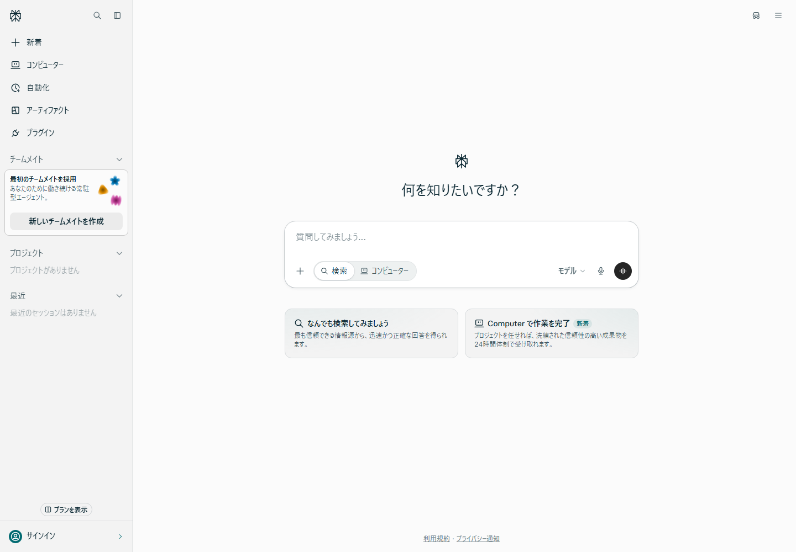
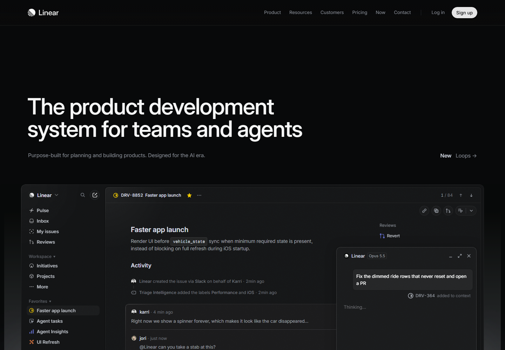
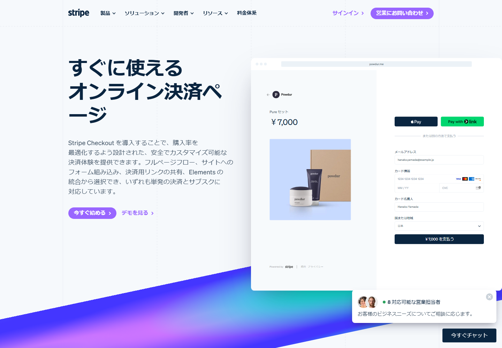
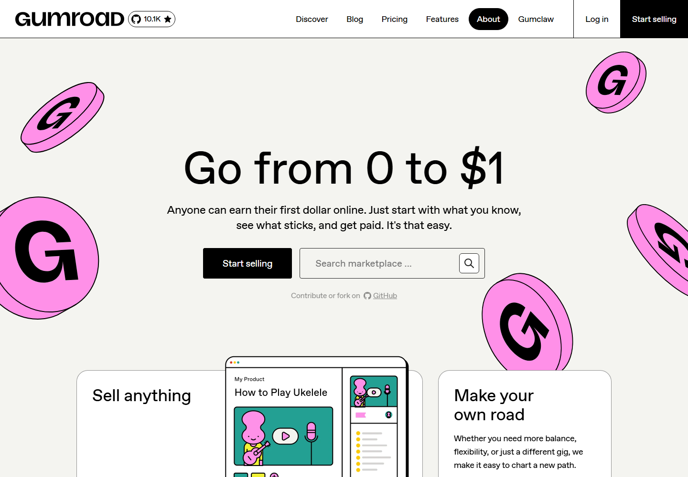
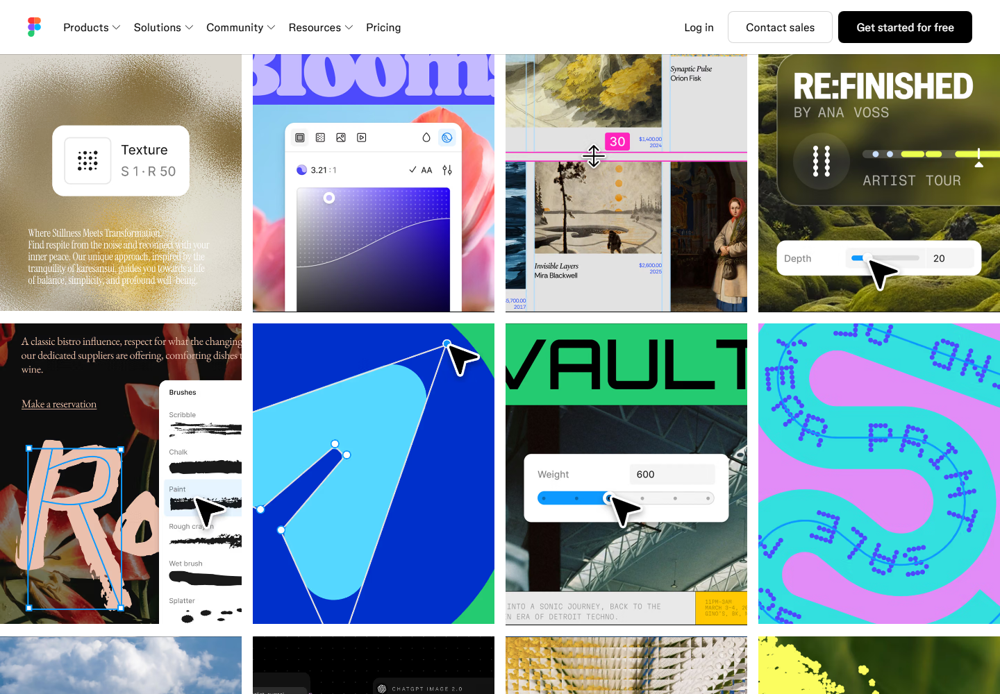
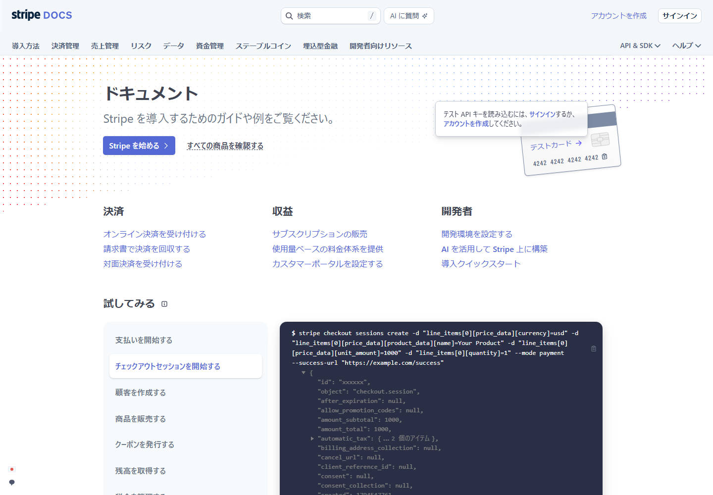
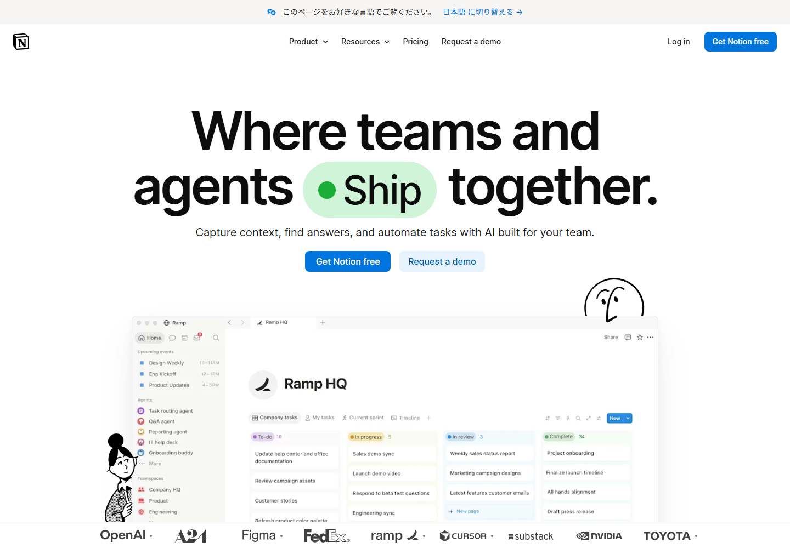
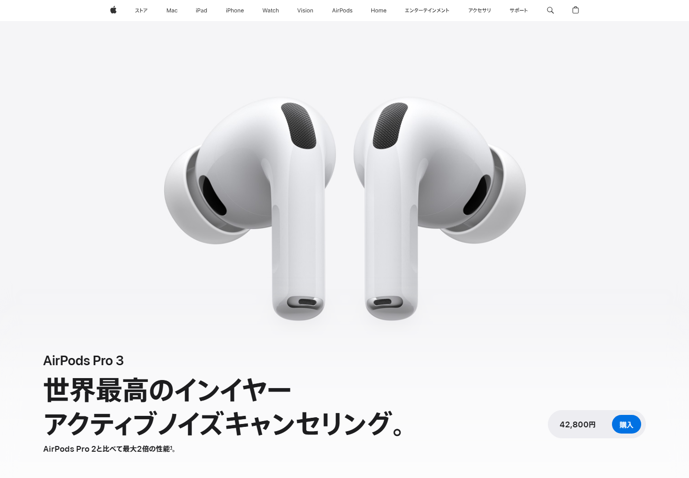
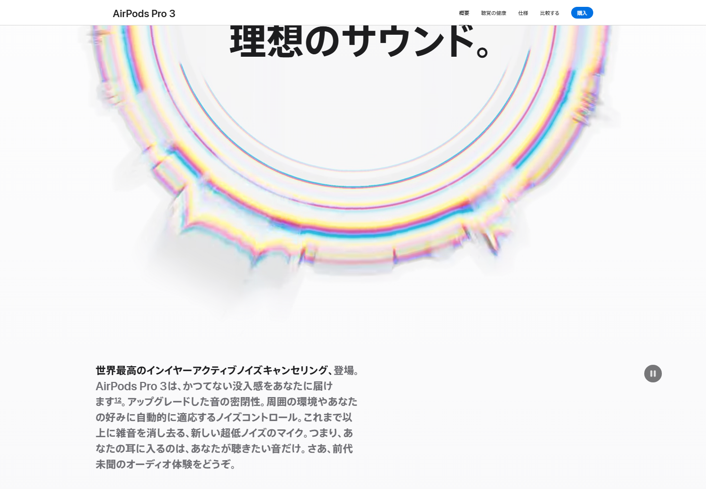
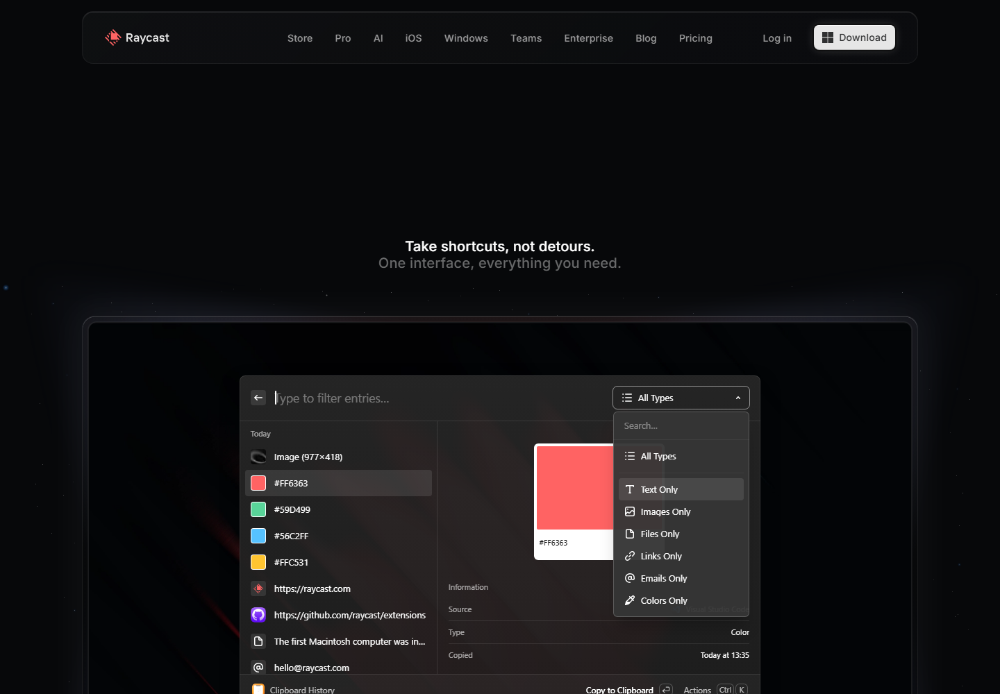

「今っぽいデザインにしたいけれど、何を取り入れればいいのか分からない」と迷うことはありませんか？

参考サイトを見て、色やアニメーションをまねするだけでは、自分のサイトに合うとは限りません。見た目と一緒に、 **「誰の、どんな困りごとを解決するデザインなのか」** を考えると、取り入れる理由が見えてきます。

この記事では、2026年のサイトづくりで参考にしたい4つの方向性を、9つの実在サイトとスクリーンショットで紹介します。
いずれも今年初めて登場した手法ではありません。以前からある設計の考え方も含めて、今のサイトにどう生かせるかを整理しました。

まず、全体像を見てみましょう。

| 方向性 | 解決したいこと | 参考サイト |
| --- | --- | --- |
| アクションファーストUI | 次の操作に迷う、同じ入力を繰り返す | Perplexity、Linear、Stripe Checkout |
| アートディレクション型UI | サービスの個性が伝わりにくい | Gumroad、Figma |
| 要約ファーストの情報設計 | 自分に必要な情報か判断しづらい | Stripe Docs、Notion |
| スクロールを使ったストーリーテリング | 製品の特徴や使う場面を想像しづらい | Apple、Raycast |

ここでの分類は、各サイトを見るための切り口です。各社がこの名称でデザインを分類しているわけではなく、1つのサイトに複数の考え方が重なることもあります。

*掲載画像は、各公式サイトを2026年11月13日に撮影したものです。表示内容は言語・端末・閲覧時期によって変わります。画像の出典は各項目のリンク先です。*

## 1. アクションファーストUI：目的に向かってすぐ動ける

アクションファーストUIは、 **ユーザーが目的を達成するための操作を、分かりやすい場所に用意する設計** です。

たとえば、予約サイトなら空き日時を選べる欄、検索サービスなら質問を入力できる欄を中心に置きます。「何ができるか」を説明するだけでなく、その場で行動を始められるようにする考え方です。

### 背景にある考え方

メニューを何度も開いたり、同じ情報を入力したりする手間を減らすことが狙いです。
AIによる支援も使えますが、入力の自動補完や、よく使う操作へのショートカットでも実現できます。

ただし、省略するのは不要な手順です。購入金額の確認や、データを削除する前の確認など、ユーザーの判断に必要な手順は残しましょう。

### Perplexity：質問の入力から調べものを始める

[Perplexityの公式サイト](https://www.perplexity.ai/)


*質問の入力欄を中心に据えた、未ログイン時の画面。*

中央の入力欄から、知りたいことをそのまま質問できます。検索の利用方法について、公式ヘルプはWeb上の情報をもとに、出典へのリンクを付けた回答を返すと説明しています。[機能の説明：What is Perplexity?](https://www.perplexity.ai/help-center/en/articles/10352155-what-is-perplexity)

参考にしたいのは、 **最初にすべき操作がひと目で分かること** です。自分のサービスでも、検索・予約・作成など、利用者が最初に取りかかる操作を目立つ位置に置けないか考えてみましょう。

### Linear：受け付けた課題を処理しやすくする

[Linearの公式サイト](https://linear.app/)


*公式サイトに掲載されている製品UIのデモ。実際のワークスペースの操作画面ではありません。*

Linearは、開発チーム向けの課題・プロジェクト管理ツールです。Triageは、外部連携などから届いた課題を受け付け、確認してからチームの作業に追加するための受信箱に当たります。採用・却下・重複の指定などを行えます。[機能の説明：Linear Docs「Triage」](https://linear.app/docs/triage)

また、課題を選択してコマンドメニューを開くと、実行する操作を選べます。[操作の説明：Linear Docs「Select issues」](https://linear.app/docs/select-issues)

ここで参考になるのは、「何を処理するか」と「どう処理するか」を近づけることです。たとえば管理画面なら、申請内容を確認する場所の近くに、承認・差し戻しの操作を置くといった形で応用できます。

### Stripe Checkout：繰り返しの入力を減らす

[Stripe Checkoutの公式サイト](https://stripe.com/jp/payments/checkout)


*公式サイト上の決済フォームのサンプル。実際の購入手続きは行っていません。*

Stripe Checkoutは、構築済みの決済画面を利用できるサービスです。Linkと組み合わせると、保存済みの支払い情報や配送先情報を再利用できます。

ただし、誰でも常に1クリックで支払いが終わるわけではありません。公式ドキュメントには、既存のLink利用者を識別し、ワンタイムコードで認証した後、情報を自動入力する流れが説明されています。[機能の説明：Stripe Docs「Link」](https://docs.stripe.com/payments/link)

参考にしたいのは、 **すでに分かっている情報を何度も入力させないこと** です。会員情報を使ったフォームの初期入力など、小さな改善から取り入れられます。

## 2. アートディレクション型UI：サービスらしさを形にする

アートディレクション型UIは、写真・イラスト・文字・配色の方向性をそろえ、 **ブランドの個性を画面全体で伝えるデザイン** です。

ここでいうアートディレクションは、「どんな印象を届けるか」を決め、そのために表現を選ぶことです。手描き風のイラストや大胆なレイアウトは、その選択肢の一部です。

### 背景にある考え方

同じような部品やレイアウトを使っていても、サービスごとに伝えたい雰囲気は違います。
親しみやすさを伝えたいのか、落ち着いた印象にしたいのか。先に方向性を決めておくと、色や写真の選び方にも一貫性が生まれます。

表現を強める場所と、操作を迷わせない場所を決めるのが実践のコツです。たとえば、見出しや挿絵で個性を出し、入力欄やナビゲーションには分かりやすい形を使います。

### Gumroad：大胆な配色とイラストで親しみを伝える

[Gumroadの公式サイト](https://gumroad.com/)



Gumroadは、クリエイターが商品を販売できるプラットフォームです。撮影時のトップページでは、ピンク色のコインのイラスト、太い文字、輪郭線のあるボタンやカードが使われていました。

注目したいのは、装飾があっても、販売を始めるボタンとマーケットプレイスの検索欄が見つけやすいことです。 **個性を出すことと、主要な操作を分かりやすくすること** を両立する参考になります。

### Figma：さまざまな表現を、制作例で見せる

[Figmaの公式サイト](https://www.figma.com/)


*トップページ内の制作例を紹介するセクション。*

Figmaの公式サイトには、タイポグラフィ、質感のある背景、図形や写真を組み合わせた制作例が並びます。ツールの機能を文章で列挙するだけでなく、作れるものの幅をビジュアルで伝えています。

参考にしたいのは、サービスの価値と表現を結び付けることです。たとえばポートフォリオなら、自分の作品を見出しや背景と組み合わせることで、得意な表現を最初の画面から伝えられます。

## 3. 要約ファースト：必要な情報かをすぐ判断できる

要約ファーストは、 **最初に要点を伝え、必要に応じて詳しい情報を読めるようにする設計** です。

TL;DRは「Too Long; Didn't Read」の略で、長い文章の短い要約を示す表現として使われます。この記事では、要約文だけでなく、短い見出しや目的別の入口も含めて考えます。

### 背景にある考え方

読者は、最初からすべての情報を必要としているとは限りません。
まず「何ができるのか」「自分の目的に合うのか」が分かると、その先を読むか判断しやすくなります。

なお、 **要約と段階的開示は別の手法** です。要約は情報を短くまとめること、段階的開示は必要に応じて追加の機能や情報を見せることです。組み合わせることはできますが、同じ意味ではありません。[考え方の参考：Nielsen Norman Group「Progressive Disclosure」](https://www.nngroup.com/articles/progressive-disclosure/)

要約を置くだけで、直帰率の低下や申込数の増加が保証されるわけでもありません。読者が必要な情報へたどり着けるかを、アクセス状況や利用者の反応から確かめましょう。

### Stripe Docs：目的別の入口を先に用意する

[Stripe Docs](https://docs.stripe.com/)



Stripe Docsのトップページには、オンライン決済、請求書、サブスクリプションなど、目的別の導入リンクがあります。APIの詳細をすべて読む前に、自分のやりたいことに合うガイドを選べます。

ここは短い要約文そのものよりも、 **大量の情報に入る前に、読むべき場所を選びやすくする設計** の参考になります。

自分の技術記事でも、冒頭に「できるようになること」「前提条件」「最短の手順」を置くと応用しやすいです。

### Notion：短いメッセージから用途の説明へ進む

[Notionの公式サイト](https://www.notion.com/)



Notionのトップページは、大きな見出しと短い説明でサービスの方向性を示し、その下に機能や用途の紹介を続けています。

ランディングページを作るなら、「何のサービスか」「使うと何ができるか」「次に何をすればよいか」を最初の画面で伝え、その後に具体的な利用例や導入事例を並べる構成が参考になります。

## 4. スクロールを使ったストーリーテリング：理解する順番をつくる

スクロールを使ったストーリーテリングは、 **ページを読み進める動きに合わせて、製品やサービスの価値を順序立てて伝える手法** です。

画面の一部を固定しながら説明を切り替える、図の表示を段階的に変えるなど、見せたい内容に応じて演出を選びます。スクロール量に応じて変化するアニメーションも、その一例です。

### 背景にある考え方

文章だけでは伝えにくい仕組みや操作を、視覚的な変化と一緒に説明することが狙いです。
たとえば、製品の全体像を見せてから細部へ進み、最後に使う場面を紹介すると、特徴を順番に理解してもらいやすくなります。

ここで大切なのは、動きに説明上の役割を持たせることです。単に次々と要素を動かすだけでは、読む人の負担が増える場合もあります。

### Apple：製品の全体像から機能の説明へつなげる

[Apple「AirPods Pro」の製品ページ](https://www.apple.com/jp/airpods-pro/)


*ページ冒頭では、大きな製品ビジュアルを見せています。*


*読み進めると、機能ごとの説明に移ります。*

撮影時のページはAirPods Pro 3の紹介でした。大きな製品ビジュアルから始まり、ハイライト、ノイズコントロール、音響性能といった説明へ進みます。画面内に大きく見せるビジュアルと、短い見出しの組み合わせが特徴です。

参考にしたいのは、製品写真の大きさだけでなく、 **何を、どの順番で理解してもらうか** です。スクリーンショットは各場面の静止画なので、切り替わり方は実際のページをスクロールして確認してみてください。

### Raycast：機能を使う場面をデモで伝える

[Raycastの公式サイト](https://www.raycast.com/)



Raycastのページでは、キャッチコピーに続いて、クリップボード履歴や拡張機能などを紹介しています。製品UIを見せるデモがあり、どんな場面で便利なのかを想像しながら読み進められます。

こちらは、機能紹介を一連の流れとして見せるLPの参考例です。ページ内のアニメーションすべてが、スクロール量に連動するとは限りません。自動再生のデモと、スクロールによる場面の切り替えは分けて観察すると、実装のヒントを得やすくなります。

### 取り入れるときに気を付けたいこと

動きがなくても、必要な情報を読める構成を先に作りましょう。スクロールの強制や長すぎる演出は、必要な情報に早くたどり着きたい人の妨げになります。

また、端末の設定で動きを減らしている利用者には、装飾的なアニメーションを控える配慮が必要です。CSSでは `prefers-reduced-motion` を使って対応できます。[実装の参考：MDN「prefers-reduced-motion」](https://developer.mozilla.org/en-US/docs/Web/CSS/Reference/At-rules/@media/prefers-reduced-motion)

たとえば、装飾に使う特定の要素だけを対象に、次のように動きを止められます。

```css
@media (prefers-reduced-motion: reduce) {
  .decorative-motion {
    animation: none;
    transition: none;
    transform: none;
  }
}
```

これは装飾用クラスの例です。JavaScriptで動かす演出や動画には別途対応が必要です。また、アニメーション前の非表示状態が残らないよう、本文が読めることも確認してください。

## まとめ

- アクションファーストUIでは、目的に向かう操作を分かりやすくし、不要な入力や手順を減らします。
- アートディレクション型UIでは、伝えたい印象に合わせて、色・文字・写真・イラストを選びます。
- 要約ファーストでは、要点や目的別の入口を先に示し、読む人が情報を選びやすくします。
- スクロールを使ったストーリーテリングでは、動きと説明の順番を結び付け、製品の理解を助けます。

すべてを一度に取り入れる必要はありません。まずは参考サイトを1つ開き、「次の操作は分かるか」「要点はどこにあるか」「動きは何を説明しているか」を見てみましょう。

そのうえで、自分のサイトで利用者が迷っている箇所を1つ選び、読みやすさと使いやすさを確かめながら改善してみてください。
